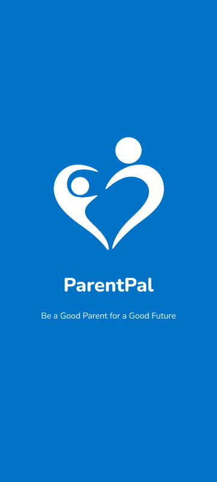
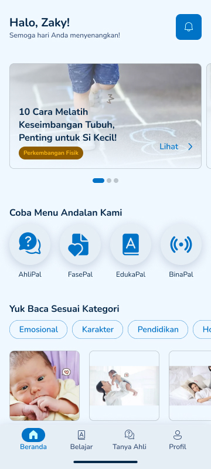
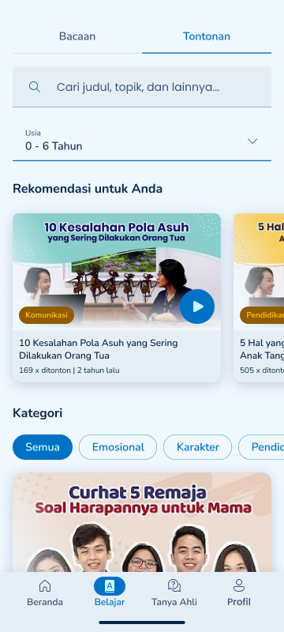
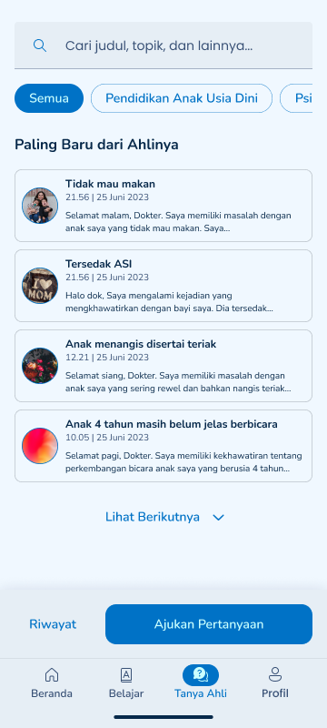
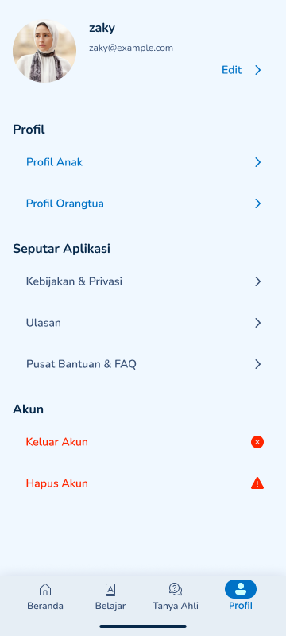
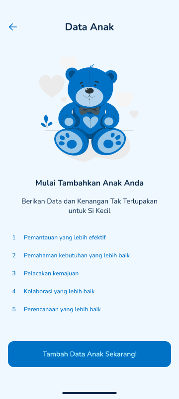

# ParentPal

ParentPal is an Indonesian-language Android app that helps parents and parents-to-be learn about raising children. It brings age- and topic-filtered articles and videos, a child data form with a BMI calculator, and an ask-an-expert section into one app.

It was built in 2023 by a team of three developers during an Android internship. Tagline: *Be a Good Parent for a Good Future*.

> **Status:** functional prototype. Authentication, onboarding, profile, and the article and video content flows work against Firebase. The Ask the Expert section and the BinaPal webinar list are interface prototypes with static sample content (see [Limitations](#limitations)).

## Screenshots

<table>
  <tr>
    <td align="center"><br><sub>Splash</sub></td>
    <td align="center"><br><sub>Home (Beranda)</sub></td>
    <td align="center"><br><sub>Learn: videos (Belajar)</sub></td>
  </tr>
  <tr>
    <td align="center"><br><sub>Ask the Expert (prototype)</sub></td>
    <td align="center"><br><sub>Profile (Profil)</sub></td>
    <td align="center"><br><sub>Child data (Data Anak)</sub></td>
  </tr>
</table>

## Features

- **Account:** email and password registration and sign-in with Firebase Authentication, a splash screen, and a three-slide onboarding shown on first launch only.
- **Personalisation:** choose a role (mother or father) and a stage (expecting or already a parent). Parents can add child data (name, birth date, gender, height, weight) with a BMI calculator.
- **Home:** greeting, banner slider, shortcuts to the four sections (AhliPal, FasePal, EdukaPal, BinaPal), 12 article categories, and the latest articles.
- **Learn:** two tabs, *Bacaan* (articles) and *Tontonan* (videos), with search and filters by age (0-6, 7-12, 13-17 years) and category. Articles are stored as HTML in Firestore and rendered in a WebView; videos link out to YouTube.
- **Ask the Expert (prototype):** question list, search, category chips, and an ask-a-question screen, built with sample content.
- **BinaPal (prototype):** a list of upcoming webinars from static content.
- **Profile:** name, email, photo, edit profile, and sign out with confirmation.

## App flow

```
Onboarding (first launch) -> Splash -> Sign in / Register
  -> Role (mother / father) -> Stage (expecting / parent)
  -> Child data (parents only) -> Home
       Home | Learn (articles, videos) | Ask the Expert | Profile
```

## Tech stack

| Area | Technology |
| --- | --- |
| Language | Kotlin |
| Platform | Android (minSdk 26, target and compile SDK 33) |
| UI | Material Components, ConstraintLayout, Navigation, ViewBinding (partial), RecyclerView |
| Auth and data | Firebase Authentication, Cloud Firestore |
| Images | Glide, Picasso |
| Content rendering | WebView (HTML articles) |

The first iteration used Firebase Realtime Database; the data layer moved to Cloud Firestore on 19 June 2023.

### Firestore data

```
mobile_users/{email}            name, email, role, stage
  data_anak/{childName}         child data (name, birth date, gender, height, weight)
artikel/{title}                 title, category, HTML content, age_id, thumbnail, date
tontonan/{id}                   title, category, YouTube link, age_id, image
```

## Getting started

1. Install Android Studio with JDK 17 and an Android SDK for API 33.
2. Open the project and let Gradle sync (wrapper uses Gradle 7.5).
3. The repository contains a `google-services.json` for the original Firebase project. To run against your own backend, create a Firebase project, enable Email/Password sign-in and Cloud Firestore, replace `app/google-services.json`, and add `artikel` and `tontonan` documents using the shape above.
4. Run the `app` configuration on an emulator or device with Android 8.0 (API 26) or newer.

## Team and contributions

Built by three developers in 2023.

- **Muhammad Adrian Zaky** ([@creamy-pandoraxx](https://github.com/creamy-pandoraxx)): authentication (sign in and register), onboarding and first-launch handling, splash screen, profile and edit profile, the article reader (WebView) and Learn tab, the Firestore content pipeline and the Realtime Database to Firestore migration. Shared work on Home, article lists, category and age filters, and the role and stage screens. About half of the Kotlin code by `git blame`.
- **anjeliputeri:** Ask the Expert, video list, BinaPal, and the child data forms, plus most layout XML.
- **nikenutari:** layout contributions.

## Limitations

This is a learning-stage prototype. Known gaps:

- Ask the Expert uses static sample questions. There is no question submission, expert answer flow, or backend yet, and the app has no user-to-user forum.
- BinaPal shows static webinar entries with no registration.
- The BMI calculator uses adult BMI thresholds. For children, growth percentiles (such as WHO growth charts) are the correct basis, so the result is informational only and not medical advice.
- Profile photos are stored as a local device URI and are not uploaded to cloud storage.
- Article and video lists are filtered on the client after loading the whole collection, with no pagination.
- Firestore security rules are not part of this repository.
- No automated tests beyond the Android template, and no CI.
- Some deprecated Android APIs and duplicated adapter code remain.

## Ideas for next steps

- Persist questions to Firestore and add an expert answer flow.
- Move data access into ViewModels and a repository layer, and add paging.
- Use WHO growth standards for child measurements.
- Add Firestore security rules, tests, and a CI workflow.
